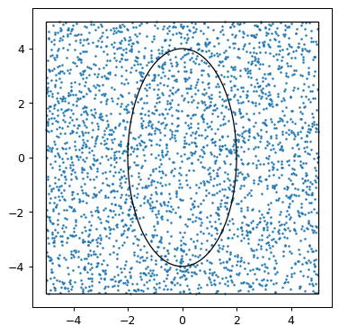
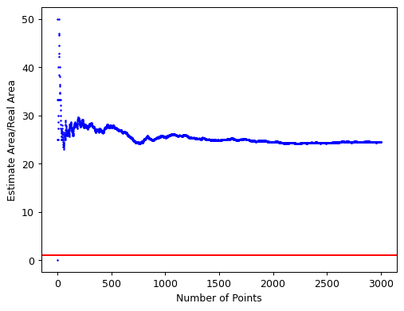
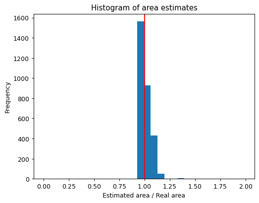

# Step 1: Original ellipse script

`ellipse_area.py` is my first version, kept exactly as I wrote it.

## What it does

1. Asks for a rectangle (its center and size) and the number of points.
2. Throws random points uniformly into the rectangle.
3. Asks for an ellipse (center `h, k` and semi-axes `a, b`) and counts the points inside it:
   `(x−h)²/b² + (y−k)²/a² ≤ 1`
4. Estimates the area as `A_box × (inside / total)` after every point, and plots the running estimate.
5. Prints a running mean, variance and skew, and draws a histogram of the estimates.

## Output

Example run: a 10 × 10 box, 3,000 points, and an ellipse with `a = 4`, `b = 2`.

| Random points | Running estimate | Histogram |
|---|---|---|
|  |  |  |

The middle plot settles near 25 (the ellipse's area, 8π), while the red reference line is drawn at 1.

## The question this raised

My professor saw the plots drift or skew away from 1 and look less random than expected. He asked me to verify whether the calculation was wrong, or whether it was just the random generator and the ellipse's shape and size. See [step 2](../02-verification-100-runs/).

## Issues I found later

- **Plotting bug (line 62):** it plots `S` (the raw area) against a red line at `y = 1`. It should plot `S/E`:
  ```python
  plt.scatter(j, S/E, color='blue', s=1)   # was: plt.scatter(j, S, ...)
  ```
- **Misleading statistics:** the mean, variance and skew are taken over the running estimates of one run. Those are not independent samples, so the skew mostly reflects which side of 1 the run happened to start on.
- **Minor:**
  - `points`, `areas`, `ConvexHull` and the first `j = 3` are unused.
  - `A` is reassigned at the end.
  - Calling `plt.scatter` once per point makes large `N` very slow.
