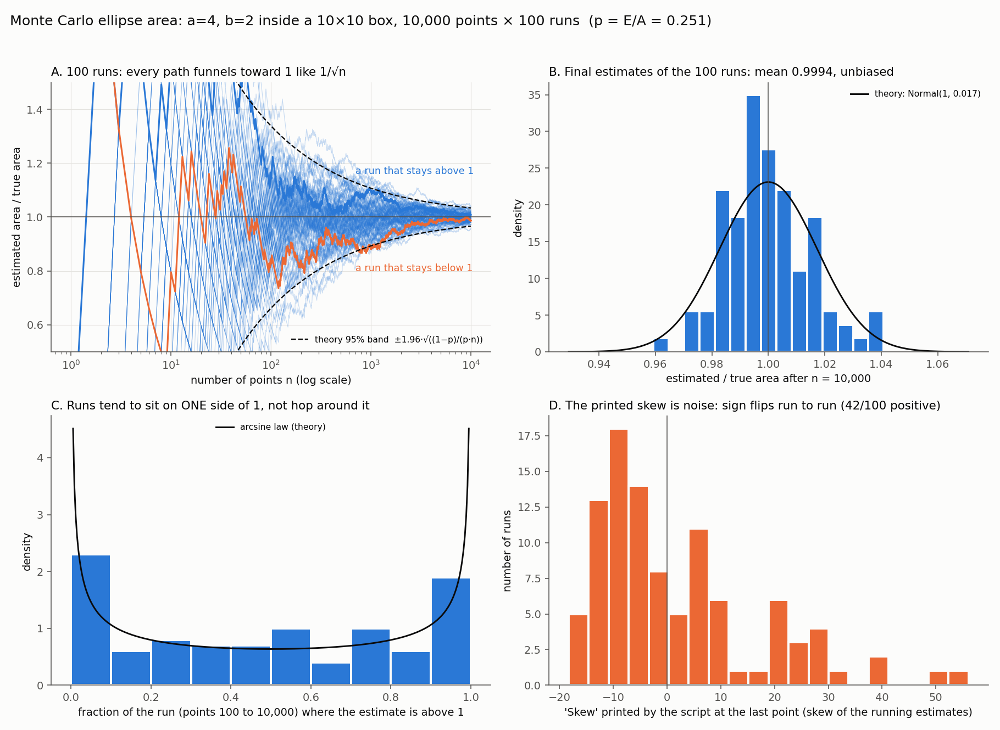

# Step 2: Verifying the method with 100 runs

**Goal:** answer my professor's question. Is the drift away from 1 caused by a mistake in my calculation, or is it just the random generator and the ellipse?

**Setup:**
- A 10 × 10 box and an ellipse with `a = 4`, `b = 2`, so the true area is 8π ≈ 25.13 and `p` = 0.251 (ellipse area ÷ box area).
- 10,000 points per run, 100 independent runs.
- The same area formula as the original script: `S = A · cumsum(inside) / j`.

```bash
python3 ellipse_100_runs.py
```



## Results

| Panel | What it shows | Result |
|---|---|---|
| **A** | Running estimate/true for all 100 runs, with the theoretical 95% band `±1.96·√((1−p)/(pN))` | Every run funnels toward 1 at the predicted `1/√N` rate. |
| **B** | Histogram of the 100 **final** estimates | Mean **0.9994**, spread 0.015 (theory 0.017), 45 above 1 and 55 below. **Unbiased.** |
| **C** | Fraction of each run spent above 1 | Most runs stay mostly on **one side** of 1. The histogram is U-shaped, matching the **arcsine law**. |
| **D** | The "skew" my original script printed, for each run | It ranged from **−18 to +56** and was positive in 42 of 100 runs. **It's noise, not an effect.** |

## Conclusion

- **The calculation is correct.**
- **The drift on a single run is normal behavior for a running average.** Each estimate shares all the earlier points, so a run stays on one side of 1 and approaches it slowly.
- **The printed skew measured nothing useful.**
- **The only real error was the plot:** it showed `S` instead of `S/E`.
