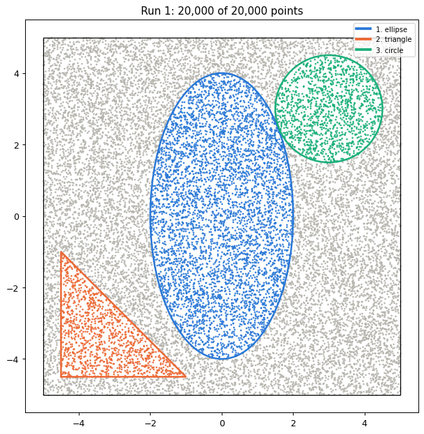
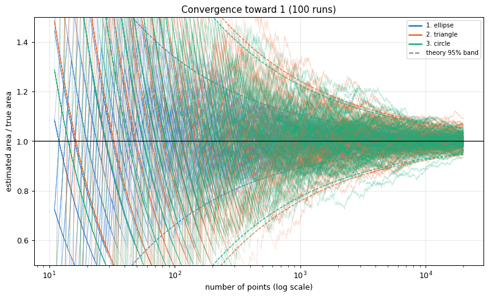
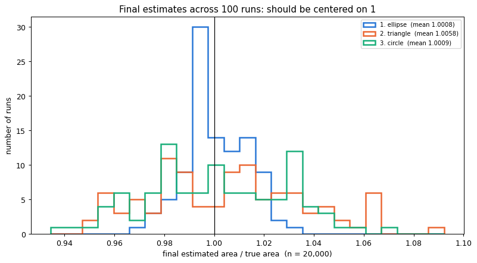
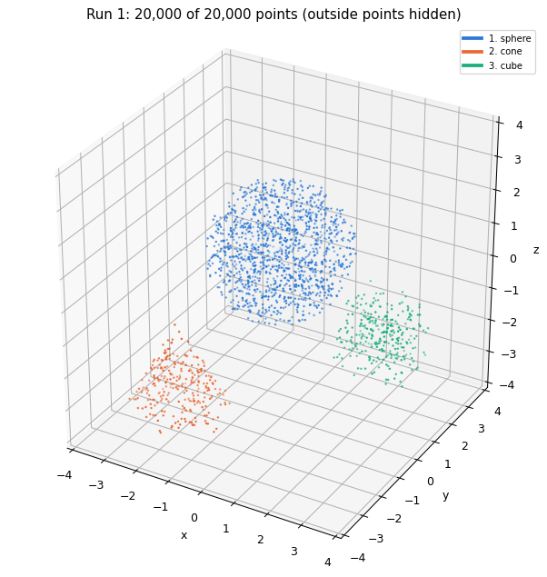
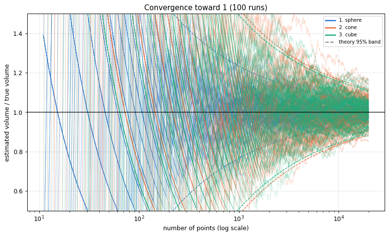
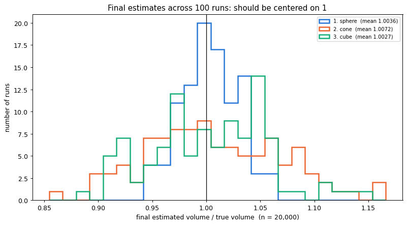

# Step 3: Multiple shapes, 2D or 3D, many runs

With the method verified, I generalized it into a terminal program.

```bash
python3 monte_carlo_shapes.py
```

**It asks for:**
1. 2D or 3D.
2. The box the points are thrown into: its center and size.
3. How many shapes, then each shape's type, position and size.
   - **2D:** circle, ellipse, square, rectangle, triangle
   - **3D:** sphere, ellipsoid, cube, box, cylinder, cone
4. The number of points per run, the number of runs, and an optional seed so a run can be repeated.

**What changed from step 1:**
- **Plots estimate ÷ true** (the fix from step 2), with the theoretical 95% band.
- **Many independent runs**, with a histogram of the *final* estimates. This is the correct way to check for bias or skew.
- **A 95% confidence interval** for each shape, plus the combined area or volume of all shapes, with overlaps counted once.
- **A warning when a shape sticks out of the box.** The estimate then converges below 1.
- **Vectorized with NumPy**, so a million points takes seconds.

## Example output

**2D:** an ellipse, a triangle and a circle, with 20,000 points and 100 runs.

| Points | Convergence (100 runs) | Final estimates |
|---|---|---|
|  |  |  |

**3D:** a sphere, a cone and a cube, with 20,000 points and 100 runs.

| Points | Convergence (100 runs) | Final estimates |
|---|---|---|
|  |  |  |
