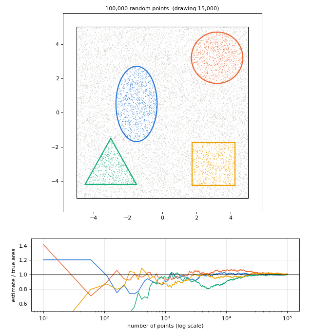
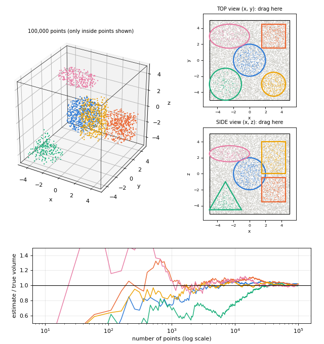

# Step 4: Interactive drag-and-drop UI

A desktop app (tkinter + matplotlib) for exploring the method visually.

```bash
python3 monte_carlo_ui.py
```

## Controls

- **2D / 3D:** switch modes at the top left.
- **Add shapes:** drag a shape button onto the plot, or click it to add the shape at the center.
- **Move shapes:** drag them on the plot. In 3D, drag in the **top view** to move a shape in x and y, or in the **side view** to move it in x and z. The 3D view can be rotated with the mouse.
- **Side panel:**
  - Edit the selected shape's coordinates and size (press Enter to apply).
  - Set the box size.
  - Change the number of points (100 to 1,000,000). "New random points" reshuffles them.
- **Results:** true value, estimate, estimate/true and a 95% confidence interval for each shape. It warns you if a shape sticks out of the box.
- **Bottom chart:** estimate/true vs. number of points, which should narrow toward 1.

## 2D



## 3D


