# Monte Carlo Simulation: Learning the Basics

Estimating areas and volumes by throwing random points, and learning how to tell a real bug from ordinary statistical behavior.

This project is part of my work learning the basics of particle physics under the guidance of **Dr. Professor Ashot Gasparian**, North Carolina A&T State University. Monte Carlo methods show up everywhere in particle physics: simulating detectors, working out what fraction of particles a detector can see (its *acceptance*), and estimating uncertainties. Before using them on physics problems, I started with the simplest version: estimating the area of an ellipse inside a box.

<p align="center">
  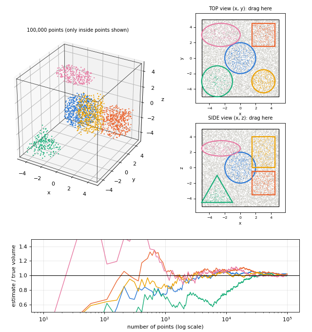
  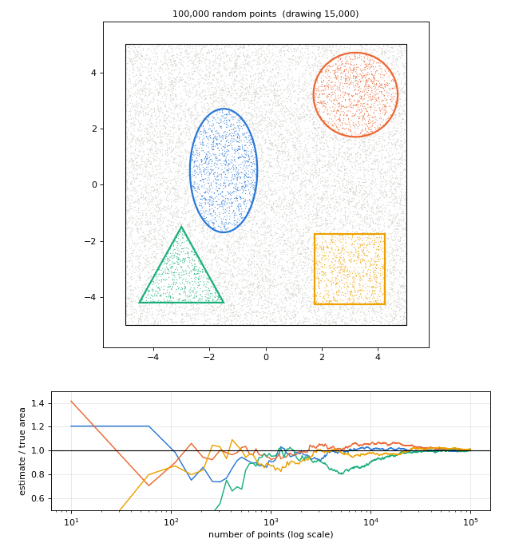
</p>
<p align="center"><i>The final version: an interactive app in 3D mode (left) and 2D mode (right).</i></p>

## Contents

1. [The idea](#the-idea)
2. [Step 1: My original script](#step-1-my-original-script)
3. [Step 2: What my professor asked me to verify](#step-2-what-my-professor-asked-me-to-verify)
4. [Step 3: Multiple shapes in 2D and 3D](#step-3-multiple-shapes-in-2d-and-3d)
5. [Step 4: Interactive drag-and-drop app](#step-4-interactive-drag-and-drop-app)
6. [Conclusion](#conclusion)
7. [What I learned](#what-i-learned)
8. [Running the code](#running-the-code)
9. [Repository layout](#repository-layout)

---

## The idea

Throw `N` random points uniformly into a box of known area `A`. Count how many land inside the shape (`N_inside`).

```
estimated area = A × (N_inside / N)
```

As `N` grows, the estimate should approach the true area, so **estimate / true area → 1**.

---

## Step 1: My original script

📁 [`01-original-ellipse/`](01-original-ellipse/)

My first version throws random points into a rectangle, counts the points inside an ellipse, and plots the running estimate after every point.

<table>
  <tr>
    <td width="33%">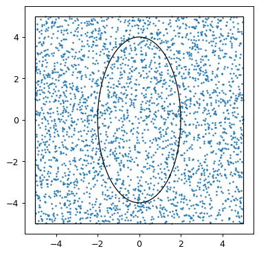</td>
    <td width="33%">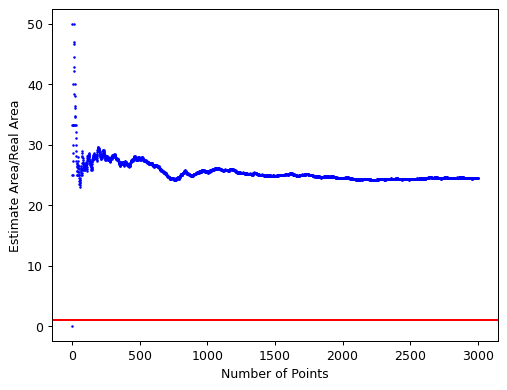</td>
    <td width="33%">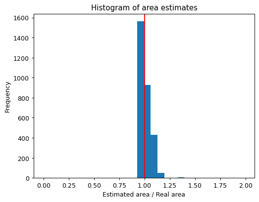</td>
  </tr>
  <tr>
    <td align="center"><b>Random points</b> thrown into a 10×10 box with the ellipse drawn on top.</td>
    <td align="center"><b>Running estimate.</b> It settles near 25 while the red line sits at 1. This turned out to be a bug.</td>
    <td align="center"><b>Histogram</b> of the running estimates from that one run.</td>
  </tr>
</table>

---

## Step 2: What my professor asked me to verify

📁 [`02-verification-100-runs/`](02-verification-100-runs/)

When I showed my first plots, Professor Gasparian pointed out two things:

1. **The estimate seemed to drift or "skew" away from 1** as the number of points grew, when it should be converging to 1.
2. **The shape of the plots didn't look random enough.** He expected the estimates to scatter more randomly.

He asked me to find out whether **something was wrong with how I was calculating**, or whether it was **just the nature of the random number generator and the shape and size of the ellipse**.

To answer this, I ran exactly the same calculation **100 times, with 10,000 points each**:

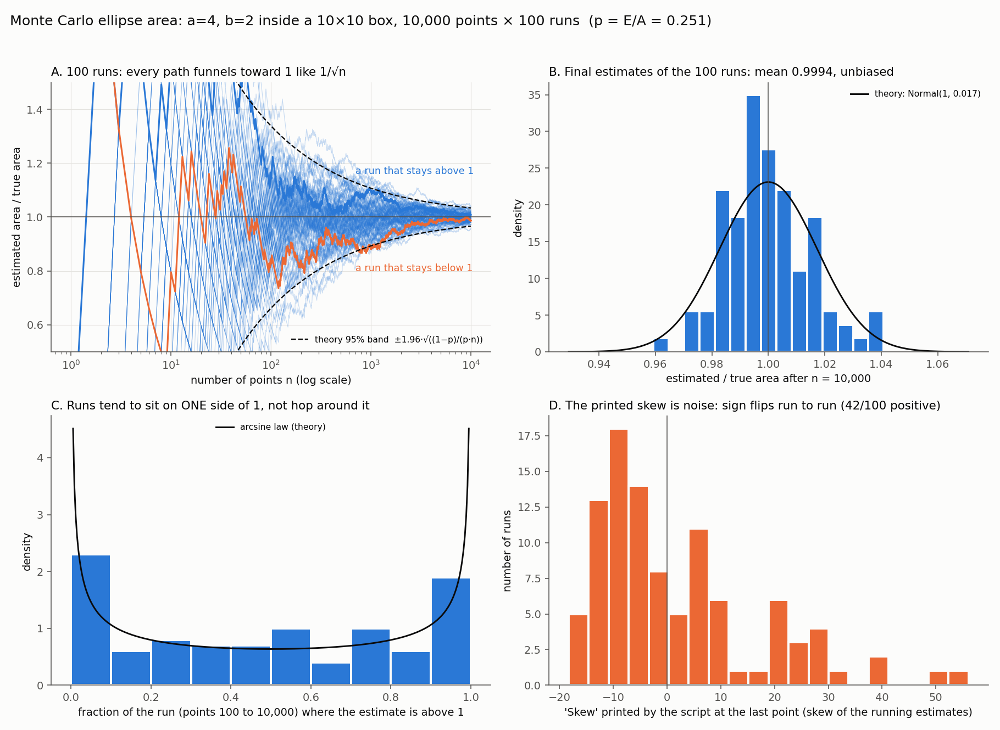

| Panel | What it shows | What I found |
|---|---|---|
| **A** | All 100 running estimates, with the theoretical 95% band | Every run funnels toward 1 at the predicted `1/√N` rate. |
| **B** | The 100 **final** estimates | Mean **0.9994**, spread 0.015 (theory 0.017), 45 above 1 and 55 below. **The calculation is unbiased.** |
| **C** | How much of each run is spent above 1 | Most runs stay on **one side** of 1. This U-shape is the **arcsine law**, which is expected for a running average. |
| **D** | The "skew" my original script printed | It ranged from **−18 to +56** and was positive in only 42 of 100 runs. **It was noise.** |

**What was actually going on:**
- **There was a plotting bug.** My plot drew the *raw area* `S` against a line at `y = 1`. It should have plotted `S / E` (estimate ÷ true area).
- **The skew statistic was misleading.** I computed mean, variance and skew over the running estimates of a single run. Those numbers are not independent: each one reuses all the earlier points.
- **The non-random look is normal.** A running average changes smoothly and can stay on one side of 1 for a long time. At small `N`, the estimate can only take the values `A·m/N` (where `m` is the number of points inside), so the early points line up along curves.

---

## Step 3: Multiple shapes in 2D and 3D

📁 [`03-multi-shape-2d-3d/`](03-multi-shape-2d-3d/)

With the method verified, I generalized it into a terminal program. It handles several shapes at once, in 2D or 3D, with many independent runs. It plots **estimate ÷ true** with the theoretical 95% band, and gives a histogram of the **final** estimates.

**2D:** an ellipse, a triangle and a circle, with 20,000 points and 100 runs.

<table>
  <tr>
    <td width="30%">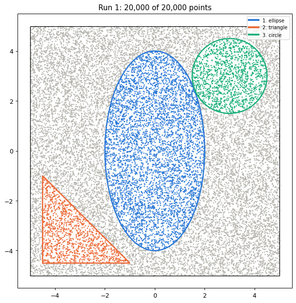</td>
    <td width="35%">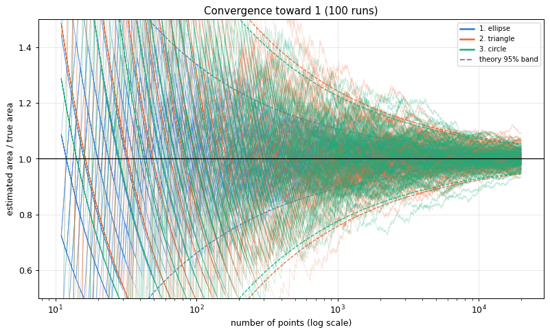</td>
    <td width="35%">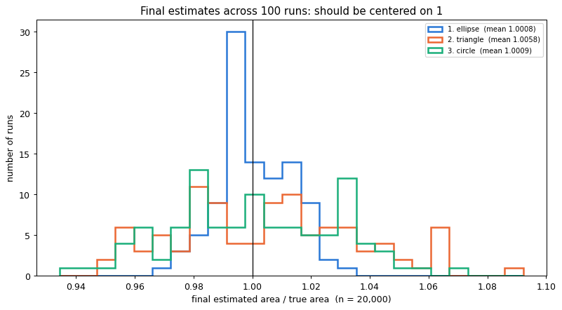</td>
  </tr>
  <tr>
    <td align="center">Points colored by the shape they land in</td>
    <td align="center">100 runs converging inside the 95% bands</td>
    <td align="center">Final estimates centered on 1 (means 1.001, 1.006, 1.001)</td>
  </tr>
</table>

**3D:** a sphere, a cone and a cube, with 20,000 points and 100 runs.

<table>
  <tr>
    <td width="30%">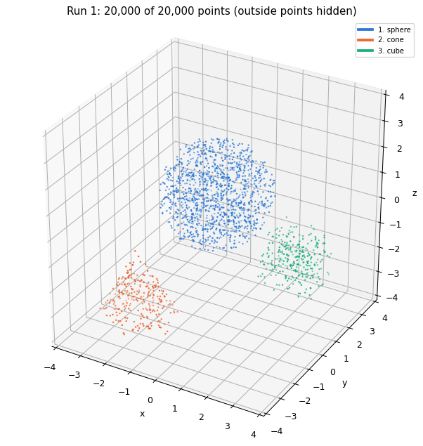</td>
    <td width="35%">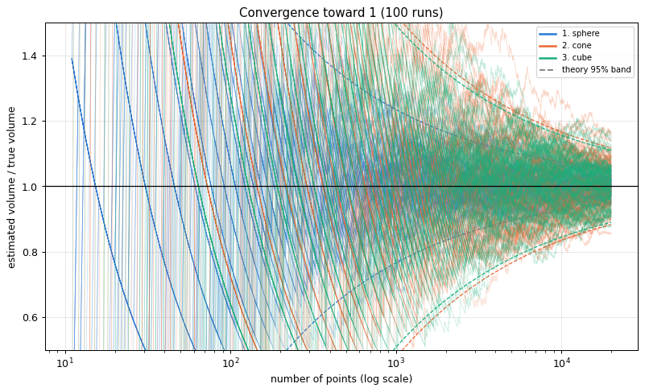</td>
    <td width="35%">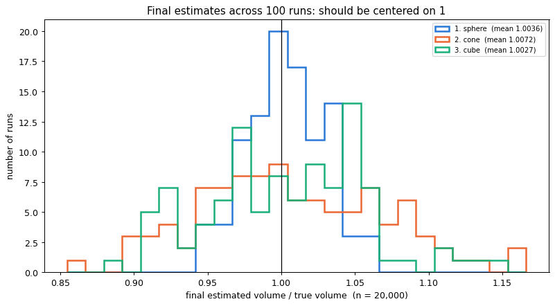</td>
  </tr>
  <tr>
    <td align="center">Points inside each 3D shape</td>
    <td align="center">Volume estimates converging toward 1</td>
    <td align="center">Final estimates centered on 1 (means 1.004, 1.007, 1.003)</td>
  </tr>
</table>

---

## Step 4: Interactive drag-and-drop app

📁 [`04-interactive-ui/`](04-interactive-ui/)

The last version is a desktop app for exploring the method visually:
- **Shapes:** drag them onto the plot and move them around.
- **Side panel:** edit coordinates and sizes, and change the number of points (100 to 1,000,000).
- **Live results:** the estimate updates as you go.

In 3D, you drag shapes in the **top view (x, y)** or the **side view (x, z)**, and the 3D view can be rotated.

<table>
  <tr>
    <td width="50%"></td>
    <td width="50%"></td>
  </tr>
  <tr>
    <td align="center"><b>2D mode:</b> four shapes and 100,000 points</td>
    <td align="center"><b>3D mode:</b> 3D view, top view, side view and convergence</td>
  </tr>
</table>

---

## Conclusion

**The Monte Carlo calculation was right.** The drift away from 1 came from two things:
- **How running averages behave:** a single run tends to stay on one side of the true value (the arcsine law).
- **One plotting mistake:** plotting `S` instead of `S / E`.

The right way to check a Monte Carlo estimator is to run it **many independent times** and look at the spread of the **final** results. That spread shrinks like **1/√N**:

```
standard error of (estimate / true) = sqrt( (1 − p) / (p · N) ),   where p = shape area / box area
```

---

## What I learned

- **How hit-or-miss Monte Carlo works,** and why its error shrinks like `1/√N`. To make it 10× more precise, you need 100× more points.
- **Plot what you mean to compare.** If the reference line is at 1, the data must be a ratio.
- **One run is not a distribution.** Statistics computed along a single running average describe that one path, not the estimator.
- **Random doesn't mean jittery.** A cumulative average is smooth and can stay on one side of the true value for a long time. That is the arcsine law, not a bad random number generator.
- **The box matters.** The smaller the shape is compared to the box (small `p`), the noisier the estimate. If the shape sticks out of the box, the estimate converges to the wrong answer (below 1).
- **The connection to physics:** counting the fraction of random events that fall inside a region is the same idea used to estimate a detector's geometric acceptance. The `1/√N` uncertainty is the same counting statistics that appear in real experiments.

---

## Running the code

Requires Python 3 with:

```bash
pip install -r requirements.txt
```

The interactive app also needs `tkinter`. On Ubuntu/Debian: `sudo apt install python3-tk`.

```bash
python3 01-original-ellipse/ellipse_area.py          # original (interactive prompts)
python3 02-verification-100-runs/ellipse_100_runs.py  # 100-run verification, saves the figure
python3 03-multi-shape-2d-3d/monte_carlo_shapes.py    # many shapes, 2D/3D, many runs (terminal)
python3 04-interactive-ui/monte_carlo_ui.py           # drag-and-drop app
```

---

## Repository layout

```
Monte-carlo-sim/
├── 01-original-ellipse/          Step 1: my first script
│   ├── ellipse_area.py
│   └── images/
├── 02-verification-100-runs/     Step 2: answering my professor's question
│   ├── ellipse_100_runs.py
│   └── images/
├── 03-multi-shape-2d-3d/         Step 3: many shapes, 2D/3D, many runs
│   ├── monte_carlo_shapes.py
│   └── images/
├── 04-interactive-ui/            Step 4: drag-and-drop app
│   ├── monte_carlo_ui.py
│   └── images/
├── requirements.txt
└── README.md
```

---

## Acknowledgments

Thanks to **Professor Ashot Gasparian** (North Carolina A&T State University) for his guidance. He asked the right questions about my results and pushed me to verify them rather than accept them.
